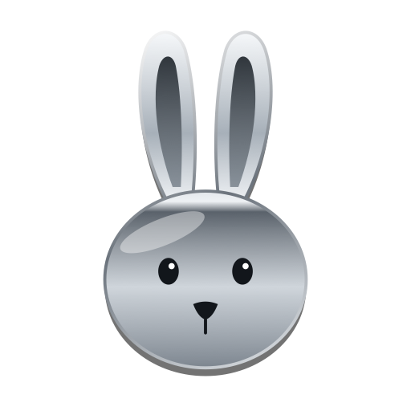

<p align="center">
  
</p>

<h1 align="center">Metal Rabbit</h1>

<p align="center">
  An on-device macOS app that notices when a quick distraction is turning into a rabbit hole of procrastination, and nudges you back before you lose the hour.
</p>

---

## What it does

Most focus apps score your whole day. Metal Rabbit answers one narrow question:

> "I'm N minutes into a distraction. What's the probability it becomes a rabbit hole?"

A menu bar app samples what you're doing every few seconds: the frontmost app, the window title and the browser domain. It never records keystrokes. A small, interpretable model watches each 2-minute window. When a break starts to look like a rabbit hole (YouTube → Reddit → YouTube, 12 minutes in), you get a nudge:

> This looks like a rabbit hole: YouTube → Reddit → YouTube, 12 min in. Head back to your editor?
> **[Back to work]** **[I'm on break]** **[Snooze 20 min]**

Each answer becomes a training label, so the model learns your habits.

**Everything stays on your Mac.** Data, training and inference all run locally on Apple Silicon. The only network use is downloading packages at build time.

## How it works

```
MetalFocusBar.app (Swift menu bar app)
  samples every 4 s ──> encrypted SQLite (SQLCipher, key in Keychain)
  shows check-ins + nudges <── notify_outbox
                                  │
Python (uv, MLX on CPU)           ▼
  data/windows   2-min windows: dominant app category, switches, idle
  labels/        rules categorizer, hindsight auto-labeler, check-ins, label merge
  hsmm/          live HSMM runner (every window) + nightly retraining
  nudge/         risk > 0.6 for 2 windows → nudge, with cooldown
  eval/          held-out-week comparison against baselines
```

- **States:** Working, Short break, Drifting (the lead-in to a rabbit hole) and Rabbit hole. Idle or lid-closed windows count as Away and never look like a rabbit hole.
- **Rabbit hole:** a distraction stretch of 20+ minutes, or one that chains through 3+ distraction apps or sites without returning to work. All thresholds live in `labels/config.yaml`.
- **Model:** a hidden semi-Markov model (HSMM) written in [MLX](https://github.com/ml-explore/mlx), with about 35 parameters. It models how long you usually stay in each state, so it can tell "this break usually ends by now" from "this one is running long." It needs only about a week of data and is easy to inspect. A GRU/hybrid model is planned once there are several weeks of data.
- **Labels:** a rules-based auto-labeler labels each day in hindsight. Occasional one-tap check-ins ("What were you doing the last 10 min?") and nudge responses override it. Random check-ins are held out as an unbiased evaluation set.

## Privacy

- No keyboard or mouse hooks of any kind. Typing, clicking and scrolling are stored only as yes/no flags per sample, read from macOS's "seconds since last input" timers.
- Banking and finance sites and apps are excluded automatically (`logger/financial.yaml`). Add your own exclusions in `logger/config.local.yaml`, which is gitignored.
- Private and incognito windows store no title or domain. URL query strings are stripped.
- The database is encrypted with SQLCipher, and its key lives in the macOS Keychain.
- macOS permissions (Accessibility, Automation) belong only to the signed app, never to Python.

## Getting started

Requirements: an Apple Silicon Mac, macOS 14+, Xcode command-line tools and [uv](https://docs.astral.sh/uv/).

```sh
# 1. Python side (uv only; it pins its own CPython 3.13)
uv sync
uv run pytest -m "not macos"

# 2. Menu bar app: create a stable signing identity once, then build and install
app/make-cert.sh
METAL_FOCUS_SIGN_ID="Metal Focus Dev" app/build-app.sh --install
open ~/Applications/MetalFocusBar.app      # grant Accessibility from the popover

# 3. Model + check-ins
uv run python -m hsmm.runner install       # live runner + 03:30 nightly retrain (LaunchAgents)
uv run python -m labels.checkins run       # check-in scheduler
```

Useful commands:

| Command | What it does |
|---|---|
| `uv run python -m logger status` | Sample count, last sample, recent events (read-only) |
| `uv run python -m hsmm.nightly --dry-run` | Preview tonight's model update |
| `uv run python -m labels.tune suggest` | Weekly threshold suggestions from your check-ins (needs 30+) |
| `uv run python -m eval.run --eval-start YYYY-MM-DD --eval-end YYYY-MM-DD` | HSMM vs baselines on a held-out week |
| `app/make-icon.sh` | Re-render `AppIcon.icns` after editing `app/Assets/rabbit-logo.svg` |

Data lives in `~/Library/Application Support/metal-focus/`. Set `METAL_FOCUS_HOME` to use a different folder.

## Repo layout

| Path | Contents |
|---|---|
| `app/` | Swift menu bar app: sampler, encrypted store, check-in panel, nudges, icon assets |
| `logger/` | Python reference sampler; its rules are the contract the Swift app follows |
| `data/` | SQLite schema and 2-minute windowing |
| `labels/` | Categorizer rules, auto-labeler, check-ins, label merge, threshold tuning |
| `hsmm/` | HSMM parameters, forward/backward passes, nightly training, simulator, live runner |
| `baselines/` | Rules and HMM baselines |
| `nudge/` | Nudge rule, cooldown and text |
| `eval/` | Held-out evaluation metrics |
| `models_later/` | GRU interface stub |

## Status

Personal project, early stage. The data pipeline, labels, HSMM and nudges work. The GRU/hybrid model, an embedding-based categorizer and benchmarks come later.
